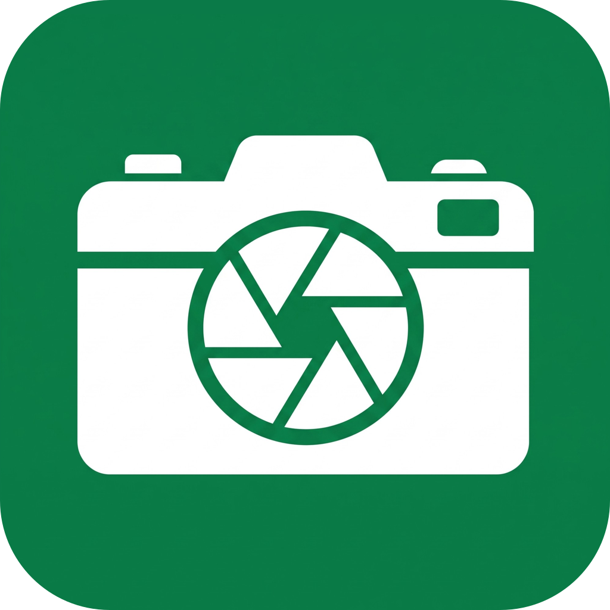

<p align="center"></p>

# tuto-record

A macOS app that saves a screenshot of every display each time you click, so your clicks can later be turned into a step-by-step tutorial. Pick a Tutorial, press Start, use your computer as usual, press Stop: the Tutorial now holds one screenshot per display per click, with a cursor arrow on a see-through red circle showing where you clicked, and the window shows them all.

Version 0.2 runs on Apple Silicon Macs.

## Using it

### Projects and Tutorials

Your work is organised in **Projects**, and each Project holds **Tutorials**. A Tutorial is the set of screenshots of one task, such as "How to install Python". On disk they are plain folders:

```
<Projects folder>/
  Python/                      ← a Project
    How to install Python/     ← a Tutorial
      2026-11-21_09-15-42-123_d1.png
      …
```

The folders are all there is: a folder you create, rename or delete in Finder shows up in the app within a couple of seconds, and the other way round.

### First launch: Settings

On first launch the **Settings** window opens by itself. It has two parts.

**Projects folder.** Press **Choose folder…** and pick the folder that holds all your Projects. The choice is remembered. **Open in Finder** shows it. If the folder is deleted or becomes read-only, both windows say so and recording is not possible until it is fixed. If you used version 0.1, its output folder is not reused: choose a Projects folder again. Your old screenshots stay where they were.

**Permissions.** tuto-record needs two macOS permissions, and asks for them one after the other:

1. **Accessibility**, so it can notice your clicks in any app. Turn tuto-record on in System Settings → Privacy & Security.
2. **Screen Recording**, so it can take the screenshots. Within a couple of seconds of granting the first one, macOS asks for this one too.

Each permission has an **Open Settings** button. macOS usually applies Screen Recording only after a restart, so press **Relaunch app** once it is on. macOS 15 and later also shows an occasional reminder that the app can record the screen; that is expected.

Open Settings again at any time with **⌘,** or the **Settings** button at the bottom of the sidebar.

### The main window

The sidebar on the left lists your Projects, newest first. Click a Project to show or hide its Tutorials, and click a Tutorial to open it on the right.

- **New Project:** press **+** next to PROJECTS, type a name, press Return (Esc cancels).
- **New Tutorial:** hover a Project and press its **+**. The new Tutorial is selected.
- **Rename or delete:** hover a row and press **⋯**, then **Rename** or **Move to Trash**. Moving a Project to the Trash takes its Tutorials with it. The app asks first, and you can get everything back from the Trash.

Names can't contain `/` or `:`, can't start with a dot, and must be different from the other names next to them (ignoring upper and lower case). The field says what is wrong as you type.

### Record

Select a Tutorial that has no screenshots yet and press **Start recording**.

- Every window of the app hides, so none appears in your screenshots.
- Every **left click** anywhere on any display saves a screenshot. Right clicks, middle clicks and scrolling do nothing. Clicks less than 0.3 seconds apart count once, so a double-click is one capture.
- The Dock icon shows a number: the captures so far.

To stop, press **⌃⌥⌘R** (Control, Option, Command, R) or click the app's Dock icon. The window comes back and shows the new screenshots. The Dock click that stops the recording is not kept as a capture.

A Tutorial holds one recording. To redo it, press **Record again** at the top right: the app asks first, moves the Tutorial's images to the Trash, and starts recording.

If saving fails (the Tutorial folder was removed, the disk is full, Screen Recording was switched off), recording stops, a notification says why, and the window shows the same message.

### Look through and clean up

The selected Tutorial shows one large image and a row of thumbnails under it, which scrolls sideways.

- Click a thumbnail, or press **←** and **→**, to move through the images.
- To remove one, hover its thumbnail and press the **✕** in its corner, or select it and press **Delete**. The app asks first, then moves the file to the Trash.
- **Open in Finder** at the top right opens the Tutorial's folder.

## What gets saved

Each counted click is one **capture**: one PNG per connected display, saved in the selected Tutorial's folder as:

```
2026-11-21_09-15-42-123_d1.png
2026-11-21_09-15-42-123_d2.png
```

- The name is the local time of the click, so the files sort in the order you clicked, which is also the order the window shows them. `d1` is the main display and the others follow from left to right.
- Each picture has the display's full pixel resolution, Retina included.
- The picture of the display you clicked also has a **marker** on it: a cursor arrow in the middle of a translucent red circle. The arrow's tip is exactly where you clicked, and the circle is see-through, so the text and buttons under it stay readable. Other displays get a plain screenshot.

## Good to know

- **Every image in a Tutorial folder belongs to the Tutorial.** PNG, JPG, GIF and WebP files you copy in show up in the window, and **Record again** moves them to the Trash too. Other files and subfolders are left alone.
- **Nothing is deleted for good.** Removing a screenshot, Record again, and Move to Trash all use the macOS Trash.
- **⌃⌥⌘R only stops a recording.** When nothing is recording it just brings the window back. Starting is always the button.
- **Screenshots are taken just after the click**, about 0.1 to 0.3 seconds later, so if the click opens a menu or changes a page, the screenshot may already show the result.
- **The cursor drawn is always an arrow**, whatever the real pointer looked like (text cursor, hand, resize handle). The real pointer is not part of a screen capture.
- **Another app may own ⌃⌥⌘R.** If so, the window warns you; stop a recording by clicking the Dock icon instead.
- **The app is not notarized by Apple.** If you receive a copy from someone else, macOS may block the first launch: right-click the app, choose **Open**, or allow it under System Settings → Privacy & Security.

## More documentation

| Document                                                | What it covers                                                                              |
| ------------------------------------------------------- | ------------------------------------------------------------------------------------------- |
| [Development guide](src/README.md)                      | Installing, building, running in development, setup, troubleshooting, and the source layout |
| [Glossary](GLOSSARY.md)                                 | The words this project uses (project, tutorial, recording, click, capture, screenshot, …)   |
| [MVP plan](plans/MVP_PLAN.md)                           | The plan for version 0.1 and its progress notes                                             |
| [v0.2.0 plan](plans/V0.2.0_PLAN.md)                     | The plan for version 0.2.0 (Projects, Tutorials, the new window)                            |
| [v0.2.0 implementation](plans/V0.2.0_IMPLEMENTATION.md) | How version 0.2.0 was built, step by step, and its progress notes                           |
| [Decision records](docs/adr)                            | Why the hard-to-reverse choices were made                                                   |
| [Working rules for Claude](CLAUDE.md)                   | How Claude works in this project, including keeping the documentation up to date            |
